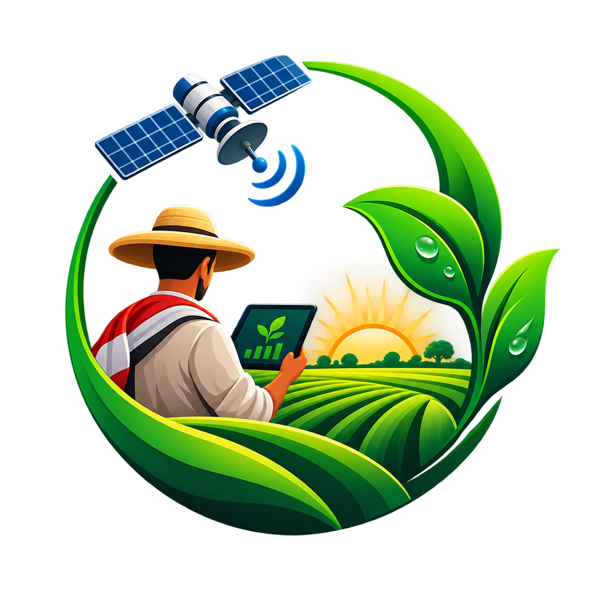

<div align="center">



# 🌱 GREEN FUTURE — Agri-Spatial Decision Intelligence Platform
### منصة الذكاء الزراعي ورصد الأرض (NASA Earth Observation Decision-Support System)

**Developed by Team ZERO SHOT | NASA Space Apps Challenge 2026 (Zagazig, Egypt)**

[](https://mas1-a.github.io/GREEN-FUTURE/)
[](https://www.spaceappschallenge.org/2026/find-a-team/zero-shot/?tab=details)
[](#-scientific-architecture--methodology)
[](#-multi-sensor-data-fusion-20162025)

</div>

---

## 🌍 Overview | نظرة عامة على المشروع

**GREEN FUTURE** is an end-to-end **Agri-Spatial Decision-Support System (DSS)** engineered for the **NASA Space Apps Challenge 2026**. Rather than serving as a black-box machine learning predictor, the platform bridges **10 years of NASA & global Earth Observation records (2016–2025)** with localized Egyptian agronomic science to empower farmers and agricultural extension engineers to design climate-resilient, water-saving crop rotations.

**منصة GREEN FUTURE** هي نظام دعم قرار زراعي وجغرافي متكامل تم تطويره ضمن تحدي **NASA Space Apps Challenge 2026**. يربط النظام بين **10 سنوات من بيانات الأقمار الصناعية ورصد الأرض (2016–2025)** وقاعدة بيانات زراعية موثقة لـ **51 محصولاً مصرياً** لمساعدة المزارع والمهندس الزراعي على اختيار الدورة الزراعية المثلى لمواجهة تغير المناخ، ندرة المياه، وتملح التربة، مع الحفاظ على الدور المحوري للخبرة البشرية والمرشد الزراعي.

---

## 🔗 Official Links | الروابط الرسمية للمشروع

| Resource | Link |
| :--- | :--- |
| 🌐 **Live Web Application (GitHub Pages)** | [https://mas1-a.github.io/GREEN-FUTURE/](https://mas1-a.github.io/GREEN-FUTURE/) |
| 🚀 **NASA Space Apps Official Team Page** | [Team ZERO SHOT — NASA Space Apps 2026](https://www.spaceappschallenge.org/2026/find-a-team/zero-shot/?tab=details) |
| 💻 **GitHub Repository** | [https://github.com/MAS1-A/GREEN-FUTURE](https://github.com/MAS1-A/GREEN-FUTURE) |

---

## 🔬 Scientific Architecture & Methodology | المعمارية العلمية للمشروع

### 1. Multi-Sensor Data Fusion & Harmonization (دمج وتوحيد البيانات الفضائية والأرضية)
To resolve spatial and temporal resolution mismatches across heterogeneous Earth Observation missions, we harmonized **6 global satellite and reanalysis sources** onto a unified **10-day Dekadal Grid** covering **14 Egyptian Governorates** over **10 years (2016–2025)** (`5,110 records × 18 core features` with zero missing values):

| Source / Mission | Variables Extracted | Agronomic Role in GREEN FUTURE |
| :--- | :--- | :--- |
| **NASA POWER** | Max/Min Temperature, Solar Radiation, Relative Humidity | Thermal stress alerts & degree-day modeling |
| **NASA SMAP & ERA5-Land** | Topsoil & Root-Zone Soil Moisture (`0–7 cm`, `m³/m³`), `ET0` | Baseline water availability & crop evapotranspiration demand |
| **NASA GPM** | Precipitation (`mm/day`) | Rainfall deficit & seasonal water gap quantification |
| **MODIS & GEDI** | `NDVI`, `EVI`, Canopy Biomass | Vegetation vigor & bare-soil fallow risk detection |
| **SRTM & OpenLandMap (SoilGrids)** | Elevation, Slope, Soil pH, Clay/Sand Fraction | Governorate soil profile & salinity/drainage susceptibility |

### 2. Machine Learning & Uncertainty Quantification (الذكاء الاصطناعي وتقدير عدم اليقين)
* **Temporal Train/Test Split:** Trained on historical records (**2016–2023**) and validated out-of-sample on (**2024–2025**) to prevent data leakage.
* **Model Benchmarking:** Evaluated statistical and ensemble models (`Ridge`, `Random Forest`, `LightGBM`, and `Gradient Boosting`), achieving **$R^2 = 87\%$** ($\text{MAE} = 0.014\text{ m}^3/\text{m}^3$) for topsoil moisture prediction under custom climate scenarios ($\Delta T$, $\Delta \text{Rain}$).
* **Confidence Intervals ($\pm \text{Uncertainty}$):** Applied Quantile Regression / tree variance to expose prediction uncertainty bounds ($\pm\text{ m}^3/\text{m}^3$), explicitly flagging seasonal transitions and bare fields prone to rapid evaporation.

### 3. Explainable Multi-Criteria Decision Engine (محرك القرار الزراعي المفسّر - MCDA)
Connected to our verified **51-crop Egyptian agronomic database** (`data/crops_database_verified.csv`), the engine dynamically synthesizes **3 tailored crop rotations** and benchmarks them against the **Traditional Baseline Rotation** (`Wheat ➔ Rice ➔ Wheat`) across:
* **Water Conservation:** Crop Evapotranspiration ($ET_c$ in $\text{mm}$ and total $\text{m}^3$ saved per feddan).
* **Natural Soil Fertility:** Biological Nitrogen Fixation ($\text{kg N/ha}$) translated into saved urea fertilizer bags.
* **Pest & Disease Cycle Breaking:** Botanical family rotation (`Crop_Family` diversification).
* **Salinity & Heat Tolerance:** Matching crop thresholds ($EC_e\text{ dS/m}$) to local soil/well water constraints.
* **Human-in-the-Loop Transparency:** Explicitly highlights satellite limitations (inability to directly measure field-level $EC_e$ or groundwater salinity) and advises local soil sampling and extension engineer consultation.

### 4. Farmer-Centered UX, Geospatial Lab & Eng. Rayan AI (واجهة المزارع، الخرائط، والمهندس رَيّان)
* **3-Step Guided Wizard + Science Lab:** Bilingual (**Arabic / English**) responsive interface with **Default Dark Mode** and printable **Multi-Plan PDF Prescription** comparing all 3 custom rotations.
* **Interactive Satellite Map (Leaflet + Esri World Imagery):** Covers all **14 Egyptian Governorates** with switchable layers for *Soil Moisture*, *Heat Stress*, and *Salinity Risk*.
* **Eng. Rayan AI (`المهندس رَيّان`):** Context-aware agricultural advisor connected directly to the user's farm profile, seasonal forecast, and all 51 crops.

---

## 👥 Team ZERO SHOT — Roles & Deliverables | أعضاء الفريق والأدوار

| # | Team Member | Role & Responsibilities | Key Deliverables | Profiles |
| :-: | :--- | :--- | :--- | :--- |
| **1** | **Mohammed Abdullah Sabry** | **Team Leader & Data Fusion Pipeline Lead**<br>GitHub architecture, multi-sensor spatial/temporal harmonization (`2016–2025`), satellite vs. ground sensor validation. | • Harmonized 10-Year Master Dataset<br>• Data Harmonization Methodology<br>• GitHub Repository & CI/CD | [](https://github.com/MAS1-A) [](https://www.linkedin.com/in/mohammed-abdullah-sabry-94bb99396/) |
| **2** | **Mohammed Monyer El Ahmady** | **AI & ML Modeling Lead**<br>Training & benchmarking `RandomForest`, `LightGBM`, and `Gradient Boosting` (`2016–2023` train / `2024–2025` test), uncertainty estimation ($\pm\sigma$). | • `models/01_ML_Soil_Moisture_Modeling.ipynb`<br>• `docs/model_comparison_metrics.csv`<br>• `docs/model_validation_charts.png` | [](https://github.com/mohamedmonyer) [](https://www.linkedin.com/in/mohamed-monyer-5199973b0/) |
| **3** | **Mohamed Elsayed Elshafie** | **Agronomy & MCDA Logic Lead**<br>Curating the 51-crop database, building the multi-criteria rotation scoring engine, pest-break logic, and agronomic risk rules. | • `data/crops_database_verified.csv`<br>• `models/mcda_engine.py`<br>• `models/02_Agronomy_MCDA_Engine.ipynb` | [](https://github.com/moshafie512) [](https://www.linkedin.com/in/mohamed-elshafie-a53232383/) |
| **4** | **Ali Abdelmenem Abdelhamid Aref** | **Geospatial & Visualization Lead**<br>Interactive satellite overlays for Egypt's 14 governorates, heat/moisture anomaly detection, and climate trend analytics. | • `models/03_Geospatial_Visualization.ipynb`<br>• Interactive Satellite Map Layers & Charts | [](https://github.com/arefali379-cpu) [](https://www.linkedin.com/in/ali-aref-534086415/) |
| **5** | **Mahmoud Nader Mohamed Harb** | **Full-Stack & Farmer UX Lead**<br>Integrating ML forecasts, MCDA rotations, Leaflet maps, bilingual dark-mode UI, PDF prescription export, and Eng. Rayan AI. | • `index.html`, `style.css`, `app.js`<br>• Live Deployed Web Platform | [](https://github.com/mahmoudnaderharb-crypto) [](https://www.linkedin.com/in/mahmoud-nader-xx-347b1a3ab/) |
| **6** | **Yousef Hassan Mohamed Mohamed** | **Pitch, Storytelling & Docs Lead**<br>Translating satellite analytics into farmer-centric storytelling, presentation deck, demo video, and NASA submission documentation. | • Pitch Deck & Demo Video<br>• Official NASA Space Apps Project Submission | [](https://github.com/youssefhassan2789) [](https://www.linkedin.com/in/youssef-hassan-404b48334/) |

---

## 📁 Repository Structure | هيكل المستودع

```text
GREEN-FUTURE/
├── index.html                                # Main 3-step wizard + Science Lab + Eng. Rayan AI UI
├── style.css                                 # Responsive Dark/Light theme & A4 PDF print layout
├── app.js                                    # Custom MCDA rotation generator, Leaflet maps, Chart.js & AI chat
├── assets/
│   ├── logo-avatar.png                       # GREEN FUTURE official platform emblem
│   └── rayan-avatar.png                      # Eng. Rayan AI advisor avatar
├── data/
│   ├── crops_database_verified.csv           # Verified 51 Egyptian crops agronomic database
│   ├── climate_14govs.json                   # Harmonized 10-year NASA climate & soil moisture records
│   └── predictions_14govs.json               # Precomputed ML forecasts & uncertainty intervals
├── models/
│   ├── mcda_engine.py                        # Multi-Criteria Decision Analysis Python engine
│   ├── 01_ML_Soil_Moisture_Modeling.ipynb    # Soil moisture model training & benchmarking notebook
│   ├── 02_Agronomy_MCDA_Engine.ipynb         # Agronomic rotation scoring notebook
│   └── 03_Geospatial_Visualization.ipynb     # Geospatial analysis notebook
├── scripts/
│   ├── get_01_nasa_power.ipynb               # NASA POWER data ingestion pipeline
│   ├── get_02_era5_land.ipynb                # ERA5-Land hydrology ingestion pipeline
│   ├── get_03_smap_soil_moisture.ipynb       # SMAP satellite soil moisture pipeline
│   ├── get_04_gpm_precipitation.ipynb        # GPM precipitation pipeline
│   ├── get_05_modis_vegetation_et.ipynb      # MODIS NDVI/EVI/ET pipeline
│   ├── get_06_gldas_terrain_soil.ipynb       # GLDAS & terrain/soil pipeline
│   └── merge_all_master.ipynb                # Multi-sensor Dekadal harmonization script
├── docs/
│   ├── model_comparison_metrics.csv          # Benchmark metrics across ML models
│   └── model_validation_charts.png           # Validation & residual diagnostic charts
├── requirements.txt                          # Python dependencies for data & modeling notebooks
└── README.md                                 # Project documentation (English & Arabic)